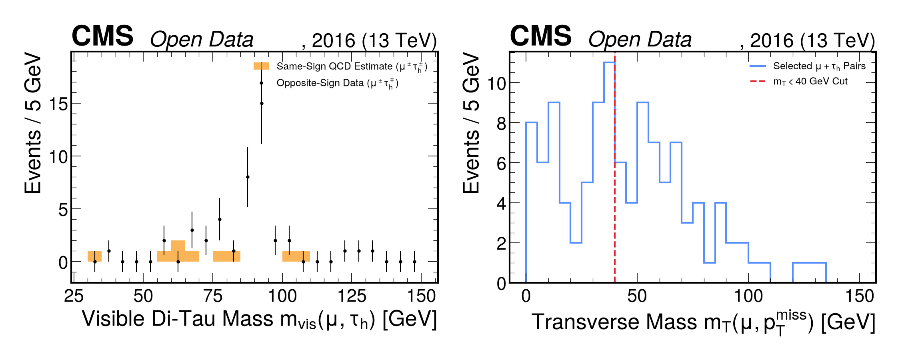
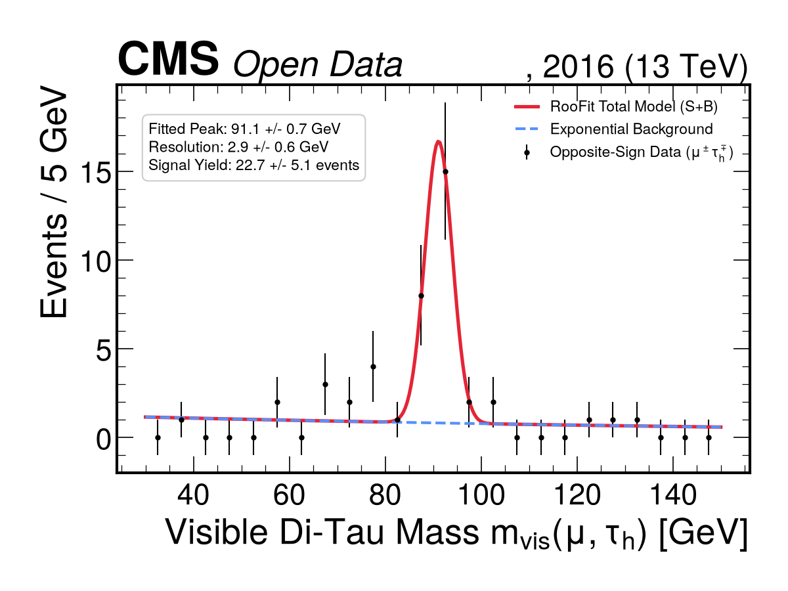

# CMS Run-2 NanoAOD Di-Tau ($\mu + \tau_h$) Reconstruction & RooFit Analysis

Columnar High-Energy Physics workflow streaming **2016 CMS SingleMuon NanoAODv9** collision data ($\sqrt{s} = 13\text{ TeV}$) over **XRootD** (`root://eospublic.cern.ch/`) using **CERN ROOT `RDataFrame`** (C++17 JIT helpers + Python) and **`RooFit`**.

* **Technical Note (PDF):** [report/cms_ditau_technical_note.pdf](report/cms_ditau_technical_note.pdf)

## Physics Selection & Background Suppression
This analysis selects opposite-sign $\mu^\pm\tau_h^\mp$ pairs from 100,000 events of the `Run2016H SingleMuon` dataset while suppressing dominant Standard Model backgrounds:
* **Muon Selection:** $p_T > 25\text{ GeV}$, $|\eta| < 2.1$, `Muon_tightId == true`, PF relative isolation $I_{\mathrm{rel}} < 0.15$.
* **Hadronic Tau ($\tau_h$) Selection:** $p_T > 20\text{ GeV}$, $|\eta| < 2.3$, spatial separation $\Delta R(\mu, \tau_h) > 0.5$.
* **$t\bar{t}$ Suppression ($b$-Jet Veto):** Vetoes events containing any jet with $p_T > 20\text{ GeV}$, $|\eta| < 2.4$, and `Jet_btagCSVV2 > 0.8484`.
* **$W+\mathrm{jets}$ Suppression:** Requires muon-MET transverse mass $m_T(\mu, p_T^{\mathrm{miss}}) < 40\text{ GeV}$, eliminating the $W \to \mu\nu$ Jacobian peak across $50\text{--}90\text{ GeV}$.
* **QCD Multijet Estimation:** Evaluated directly from data using the same-sign ($\mu^\pm\tau_h^\pm$) control region.

## Reconstructed Visible Mass & Transverse Mass Distributions


## Binned Maximum-Likelihood Fit (`RooFit`)
Fitting the opposite-sign $m_{\mathrm{vis}}(\mu, \tau_h)$ spectrum with a Gaussian signal model plus an exponential continuum background yields:
* **Fitted Resonance Peak:** $91.1 \pm 0.7\text{ GeV}$ (dominated by $Z \to \ell\ell$ where the second lepton is reconstructed as a $\tau_h$ candidate, alongside the lower-mass $60\text{--}80\text{ GeV}$ shoulder from genuine $Z \to \tau^+\tau^-$ decays with escaping neutrinos).
* **Mass Resolution ($\sigma$):** $2.9 \pm 0.6\text{ GeV}$
* **Extracted Signal Yield ($N_{\mathrm{sig}}$):** $22.7 \pm 5.1\text{ events}$



## Reproducibility (`pytest` & `Snakemake`)
```bash
PYTHONPATH=. pytest -v
snakemake --cores 1
git clone https://github.com/FahadAthoy01/cms-nanoaod-ditau-analysis.git
    cd cms-nanoaod-ditau-analysis
    PYTHONPATH=. pytest -v
    snakemake --cores 1

## Dataset Citation
CMS Collaboration (2024). *SingleMuon primary dataset in NANOAOD format from RunH of 2016 (`Run2016H-UL2016_MiniAODv2_NanoAODv9-v1`)*. CERN Open Data Portal. DOI: `10.7483/OPENDATA.CMS.A342.9982`.
